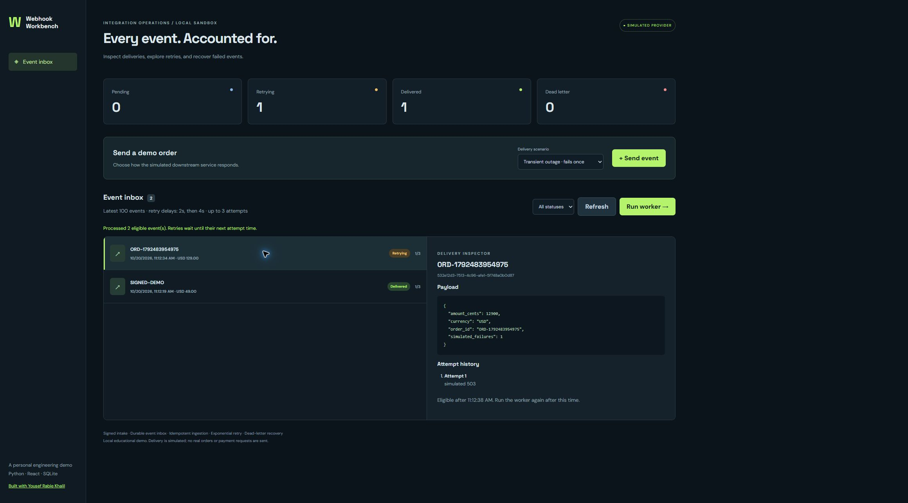

# Webhook Workbench

**A Python + React integration sandbox for inspecting webhook delivery and recovery.**

A personal portfolio project by [Yousef Rabie Khalil](https://github.com/YousefRabieKhalil).
Built with AI assistance as an educational demonstration; it contains no employer code,
customer data, or claims about production deployments.



## What it demonstrates

- A React operations dashboard backed by a FastAPI application.
- HMAC-SHA256 signature verification over a timestamp and the raw request body.
- Durable SQLite ingestion with an event-ID uniqueness constraint and conflict detection.
- A deterministic worker tick with exponential retry delays and a three-attempt budget.
- A dead-letter workflow with an explicit manual replay and preserved attempt history.
- Automated tests for invalid signatures, duplicate requests, concurrency, retries, and recovery.

The downstream provider is **simulated**. No requests are sent to real commerce or payment systems.

## Run locally

Requires Python 3.11+ and Node.js 22.12+.

```sh
git clone https://github.com/YousefRabieKhalil/webhook-workbench.git
cd webhook-workbench
python -m venv .venv
```

Activate the environment:

```sh
# macOS / Linux
source .venv/bin/activate
# Windows PowerShell
.\.venv\Scripts\Activate.ps1
```

Install dependencies, build the frontend, and serve everything from one origin:

```sh
python -m pip install -r requirements.txt
npm --prefix frontend ci
npm --prefix frontend run build
python -m uvicorn backend.app:app --host 127.0.0.1 --port 8000
```

Open **http://127.0.0.1:8000**. Interactive API documentation is at **/docs**.

For frontend development, run `npm --prefix frontend run dev` in another terminal.
Vite proxies `/api` requests to the Python server on port 8000.

## Try the lifecycle

1. Select **Transient outage** and send an event.
2. Click **Run worker**. The event enters `retrying`.
3. Wait at least two seconds, then run the worker again. It becomes `delivered`.
4. Send a **Persistent outage** event. Run the worker, wait two seconds, run it,
   wait four seconds, and run it again. It enters `dead_letter`.
5. Select the event, choose **Clear simulated outage & replay**, and run the worker.
   The event is delivered; the old attempts remain visible.

Worker ticks are deliberately manual so the state transitions can be inspected.
Refreshing the page preserves events because the inbox is stored in SQLite.

## Exercise signed intake

With the server running:

```sh
python scripts/send_webhook.py
```

The script sends the same signed event twice, demonstrating duplicate detection.
The UI's demo producer is a separate local convenience endpoint; signature behavior
is exercised through `/api/webhooks`, the script, and tests.

| Variable         | Default                       | Purpose                                    |
| ---------------- | ----------------------------- | ------------------------------------------ |
| `WEBHOOK_SECRET` | `local-demo-secret-change-me` | Shared HMAC secret for local signed intake |
| `DATABASE_PATH`  | `events.db`                   | SQLite database file                       |

Set the same `WEBHOOK_SECRET` in the server and sender environments when overriding it.
Timestamp tolerance is five minutes. Event IDs are unique across this single demo source.

## Verify

```sh
python -m pytest backend -q
npm --prefix frontend run build
```

GitHub Actions runs both checks on pushes and pull requests.

## Architecture and tradeoffs

See [the architecture guide](docs/architecture.md) for the state machine, transaction
boundaries, delivery semantics, and production considerations.

This is a **trusted local sandbox**, not an internet-ready service. Demo, worker,
listing, and replay endpoints have no authentication. Run it on loopback only.
It intentionally uses simulated delivery inside a short database transaction; a real
HTTP integration should use a separate worker, leases, timeouts, and consumer idempotency.
No exactly-once delivery guarantee is claimed.

## Repository map

```text
backend/app.py           API, persistence, state transitions
backend/test_app.py      Behavioral and concurrency tests
frontend/src.jsx        React dashboard
frontend/style.css      Responsive styling
scripts/send_webhook.py  Signed intake / duplicate example
docs/architecture.md    Design decisions and limitations
```

## Next exercises

- Separate the worker process and introduce leases with crash recovery.
- Implement a provider adapter against a local mock server with timeouts.
- Add PostgreSQL and per-source event identity for multiple producers.
- Add authentication, authorization, rate limits, retention, and structured telemetry
  before considering any public deployment.
