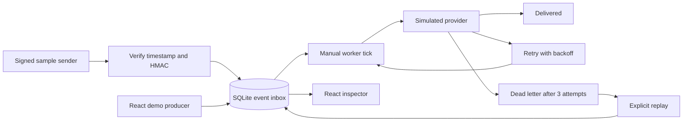

# Architecture

## Flow

## Ingestion

The webhook receiver verifies `HMAC(secret, timestamp + "." + raw_body)`.
The signature is compared in constant time, the timestamp must be within five minutes,
and the body is limited to 16 KiB before validation. This proves possession of the
shared secret, not the identity of a distinct tenant.

An event ID is a primary key. Under `BEGIN IMMEDIATE`, the receiver checks for an existing
event before inserting. Equal normalized payloads return `duplicate: true`; conflicting
payloads return HTTP 409. Concurrent arrivals serialize through SQLite, preventing two
records for the same event. The acknowledgment occurs after commit.

Canonical comparison uses validated model values. Unknown JSON fields are ignored by
the model, so they are not part of the deduplication contract. Money is stored as integer
minor units to avoid floating-point comparisons.

## Processing

`pending → delivered` on success.

`pending → retrying → delivered` for temporary failures.

`pending → retrying → retrying → dead_letter` when all three attempts fail.

One worker tick processes up to 20 eligible records in a transaction. A failure schedules
the next eligible time using `2 ** attempt` seconds: two seconds after attempt 1, four
after attempt 2. The third failure is terminal. A manual replay clears the simulated
outage and resets the attempt budget, while preserving history with a replay marker.

The provider response is calculated locally from `simulated_failures`. There are no
network side effects. A database rollback therefore also rolls back all state changes
in the tick. This simplification is intentional and must not be confused with atomicity
between a real provider and a local database.

## Why this design

**SQLite:** zero service setup and durable state make the demo easy to review. A single
writer limits throughput, and transactions serialize worker ticks. PostgreSQL plus
row-level locking or a queue would be appropriate for larger workloads.

**Manual worker:** makes failures and retry timing visible without background activity.
Production should schedule work continuously rather than depend on a UI button.

**One application:** keeps the example runnable while separating intake, storage,
processing, and UI responsibilities. This demonstrates event-driven processing concepts,
not a deployed fleet of microservices.

**Simulated provider:** makes tests deterministic and avoids real payment or order traffic.
Real delivery needs bounded timeouts, retry classification, jitter, connection pooling,
and per-provider policies.

## Delivery semantics and gaps

Ingestion is idempotent for each event ID in this single-source database. External
delivery is not implemented. A production worker may crash after sending but before
recording success; consumers must tolerate retries. Leases, an outbox where appropriate,
and idempotency keys address this boundary without claiming exactly-once delivery.

Before public deployment: remove or secure demo routes; authenticate operator actions;
add authorization and tenant isolation; store secrets securely; add rate limits and
request deadlines; define retention and redaction; and collect structured logs, metrics,
and traces. The current listing returns the newest 100 events, while totals cover all rows.

## Review questions

1. Why must acknowledgment follow the durable insert?
2. What happens if two senders reuse an event ID with different payloads?
3. Why is a database lock insufficient for exactly-once external delivery?
4. Which HTTP responses should be retried, and which should fail permanently?
5. How would a lease be recovered after a worker process dies?
